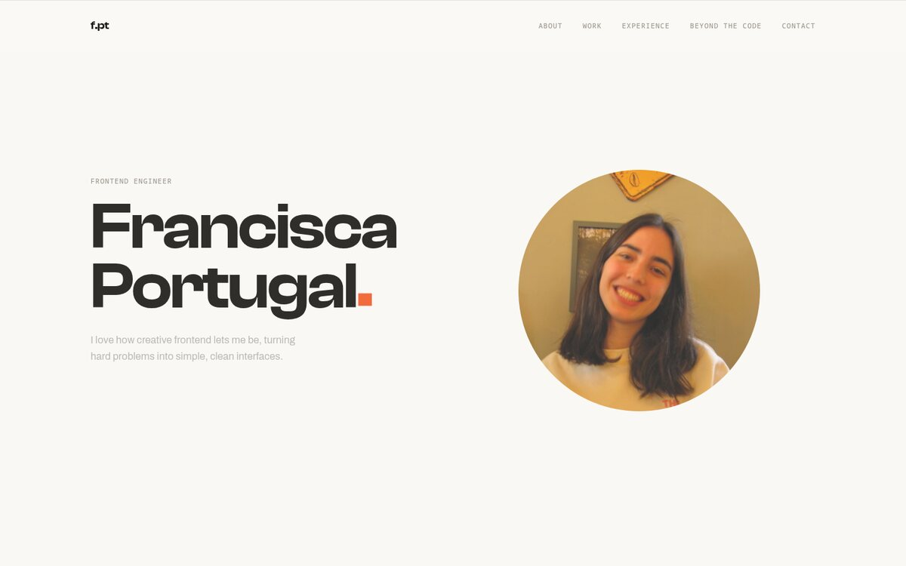

# Francisca Portugal — Portfolio

A personal portfolio for frontend work: a project gallery, experience timeline, and interactive details.

<p align="left">
  <a href="https://franciscapt.dev"></a>
</p>

<p align="left">
  
  
  
  
  
</p>

## About

Personal portfolio website showcasing my work as a frontend engineer. Features a modern, responsive UI, project gallery, experience timeline, and interactive components.

**Live:** [franciscapt.dev](https://franciscapt.dev)

## Screenshot



## Features

- Responsive design for all devices
- Project gallery with detailed views
- Experience timeline
- Interactive UI elements (squishy portrait, scroll-driven chat animation)
- Fast performance with Vite
- Built with accessibility in mind

## How It Works

The site is a React 19 single-page application built with Vite and Tailwind CSS v4. The
contact form posts to a Cloudflare Pages Function, which sends the message through Resend;
everything else is static.

**Folder Structure**

```
portfolio/
├── functions/           ← Cloudflare Pages Functions (contact email API)
├── public/
│   └── images/
│       ├── people/
│       └── projects/
├── src/
│   ├── assets/
│   ├── components/
│   │   ├── effects/     ← Animation/interactive components
│   │   ├── error/       ← Error boundaries
│   │   ├── forms/       ← Form components
│   │   ├── layout/      ← Header, Footer
│   │   ├── sections/    ← Page sections
│   │   └── ui/          ← Reusable primitives
│   ├── data/
│   ├── lib/             ← Shared constants
│   ├── style/
│   ├── App.tsx
│   └── main.tsx
├── index.html
├── package.json
├── tsconfig.json
├── vite.config.js
└── README.md
```

## License

No license file is included. The source is public for reference; all rights reserved.

---

_Portfolio — built to show the work, not just list it._
